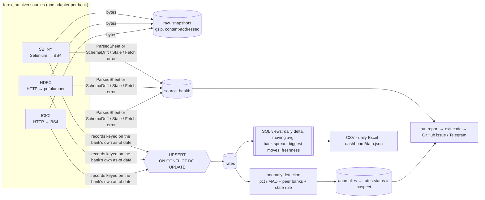

# Forex Rate Archiver

[](https://github.com/Pranjal-agl/forex-rate-archiver/actions/workflows/daily_scrape.yml)
[](https://github.com/Pranjal-agl/forex-rate-archiver/actions/workflows/ci.yml)


A daily ETL pipeline that archives the USD → INR rates published by **SBI (New York)**, **HDFC Bank** and **ICICI Bank**. None of the three offers a historical API. Each source needs a different extraction technique:

| Source | Publication | Fetch | Parse |
|---|---|---|---|
| SBI New York | remittance-slab table on a web page | **Selenium** (headless Chrome), plain HTTP fallback | BeautifulSoup |
| HDFC Bank | daily *Treasury Forex Card Rates* PDF | HTTP | **pdfplumber** (PDF table extraction) |
| ICICI Bank | forex card-rate page | HTTP, Selenium fallback | **BeautifulSoup** |

Rows land in a **SQLite** database through idempotent upserts. They are checked by anomaly detectors that were evaluated on injected faults, and exported to CSV, a daily Excel file and a static dashboard. GitHub Actions runs everything daily, and opens a GitHub issue when something breaks.

---

## Architecture



```
forex_archiver/
├── sources/        base.py (Source interface, retries, fallbacks, freshness) + sbi.py, hdfc.py, icici.py
├── fetchers.py     http_get / browser_get (Selenium); bot-wall and empty-body detection
├── retry.py        exponential backoff with full jitter; retries FetchError only
├── db.py           SQLite: runs, snapshots, health, upserts, anomaly replacement
├── schema.sql      tables, constraints, indexes, analytics views (window functions)
├── anomaly.py      pct / MAD jump detectors, peer-bank adjustment, stale-value rule
├── evaluation.py   fault injection + precision/recall sweep
├── cleaning.py     pandas normalisation / dedup (legacy CSV import)
├── export.py       CSV, Excel, dashboard JSON
├── pipeline.py     orchestration + RunReport (status, exit code, markdown)
└── cli.py          forex-archiver run | import-csv | detect | evaluate | replay | export | sql
```

Adding a bank means writing one `Source` subclass: declare `urls`, `strategies` and `headline_label`, implement `parse(bytes) -> ParsedSheet`, and register it.

## Quick start

```bash
pip install -e ".[dev]"
forex-archiver run                      # fetch all banks, update data/forex.db + exports
forex-archiver run --banks hdfc icici   # subset
forex-archiver sql "SELECT * FROM v_bank_spread ORDER BY rate_date DESC LIMIT 5"
forex-archiver evaluate                 # regenerate reports/anomaly_eval.md
pytest --cov                            # offline; uses saved bank pages
```

Dashboard: open `dashboard/index.html` through any static server, or via GitHub Pages. It loads `dashboard/data.json` and falls back to the copy on `main`.

## Data model

`data/forex.db` is the source of truth; everything else is regenerated from it (`forex-archiver export`).

| Table / view | Grain | Purpose |
|---|---|---|
| `runs` | one per pipeline run | start/finish, status (`ok` / `partial` / `failed`), trigger, git SHA |
| `raw_snapshots` | one per unique response body (sha256) | where the gzipped bytes are; enables replay after a parser fix |
| `source_health` | run × source | ok, latency, attempts, records, as-of date, error type and message |
| `rates` | **(rate_date, bank, label)**, primary key | the cleaned rate; `CHECK` on rate > 0 and ISO date; `status` ok/suspect; `revisions` counter |
| `anomalies` | (rate_date, bank, label, method) | why a row is suspect: method, score, threshold, reason |
| `headline_labels` | bank | which label is compared across banks (SBI `less than $2,500`, HDFC/ICICI `TT Buying`) |
| `v_daily_delta` | rate row | `LAG()` previous observation, delta, % change |
| `v_moving_avg` | rate row | 7- and 30-observation moving averages (`AVG() OVER ROWS …`) |
| `v_bank_spread` | day | max − min headline rate across banks |
| `v_biggest_moves` | series | top-5 daily moves (`RANK() OVER`) |
| `v_freshness`, `v_source_reliability` | series / source | staleness and success rate, used for alerting and the dashboard |

`all_rates_history.csv` columns: `Bank, Slab_Type, Rate, Date, Status`. `Date` is the **bank's published as-of date**, not the day the scraper ran.

## Data quality

**At parse time** (`SchemaDriftError`, `StaleDataError`). Parsers find columns by header text and validate what they read: rates must be strictly numeric, buy must be below sell, SBI slabs must be complete and non-decreasing, and the sheet's own date must be present and no more than 5 days old. Anything unexpected fails the source loudly instead of producing a plausible-looking number. The raw bytes that broke a parser are committed to `snapshots/failures/`, so the fix can ship with a regression fixture.

**After loading** (rows marked `suspect`, never deleted). Detection reruns over the full history every run, so flags are a pure function of the data plus the config in `forex_archiver.toml`. Thresholds can also be overridden with environment variables (`FOREX_PCT_THRESHOLD=2`):

* **Jump rule.** `pct` (|move| > X %) or `mad` (robust z-score on log returns, median/MAD over the last 20 accepted moves). Each value is compared with the *last accepted* value, so a single bad print flags one day, not also the recovery. A flagged value that the next day confirms is treated as a level shift, and the baseline moves to it.
* **Peer-bank adjustment.** Each bank's move is scored *net of the median move of the other banks*. A market move shows up at every bank on the same day; a scraping error shows up at one. Two passes keep one bank's bad print out of the others' baselines.
* **Stale rule.** The same value for ≥ 5 consecutive observations.

### Evaluation on injected faults

From [`reports/anomaly_eval.md`](reports/anomaly_eval.md). The setup is 120 synthetic markets × 3 correlated banks × 260 business days, with volatility regimes and fat tails, calibrated to the archive's measured 0.44 % daily vol. Faults were injected independently per bank: spikes of 0.5–20 % and 2–4 % level shifts.

| detector (default threshold) | precision | recall | F1 | false alarms / series-year |
|---|---|---|---|---|
| pct 1.5 % | 0.564 | 0.780 | 0.655 | 3.6 |
| MAD z > 6 | 0.730 | 0.648 | 0.687 | 1.4 |
| MAD z > 6 + peers | 0.864 | 0.756 | 0.806 | 0.7 |
| **pct 1.5 % + peers (default)** | **0.916** | **0.771** | **0.837** | **0.4** |

Stale rule at `stale_days=5`: precision 0.997, recall 0.971.

The finding I did not expect: **cross-bank context matters far more than the choice of estimator.** On a single series, MAD does not beat a well-tuned percent rule (best F1 0.687 vs 0.721). The robust estimator's selling point, adapting to volatility regimes, matters less once the market component is removed by netting against peers. MAD is still available (`anomaly_method = "mad"`) for a setup with only one source.

On the real archive, the stale rule immediately flags **35 HDFC rows (2026-03-26 → 2026-04-29) frozen at 94.24**. The old scraper fell back to a hard-coded PDF URL that kept serving an old sheet.

## Testing

`pytest` runs 67 tests offline at about 90 % line coverage. The network fetchers (`fetchers.py`) are the main untested code; they get exercised by the daily run.

* **Fixture tests.** Real SBI, HDFC and ICICI pages and PDFs captured from a GitHub Actions runner (`tests/fixtures/`), including the stale 2025 HDFC sheet.
* **Fault-injection suite.** 30 mutations of those real fixtures, each of which must be *rejected*: renamed or shifted columns, dropped rows, swapped buy/sell, `N/A`/`-`/typo cells, missing dates, JS-only pages, truncated or garbage PDFs, bot walls, empty bodies.
* **Pipeline tests.** End to end into a temp DB, covering: idempotent re-runs; partial failure → exit 2 with failure bytes kept; total failure → exit 1; spike → quarantined row + alert; stale feed → exit 2.
* **Property-based test** (Hypothesis): any sequence of upserts, duplicates included, equals a last-write-wins map.
* CI also runs an import smoke test, the exact bug class that broke this pipeline for six months.

## Runbook: a source broke

You'll get a GitHub issue labelled `pipeline-alert` with the run report: which source, which error type, the as-of dates, and a link to the run. GitHub also emails you about the failed job.

| `error_type` | Meaning | What to do |
|---|---|---|
| `FetchError` | network, HTTP ≥ 400, bot wall, empty body; already retried with backoff on every strategy | Re-run the workflow. If it persists, open the URL in a browser: has the domain or path moved? (HDFC, ICICI and SBI India moved to `*.bank.in` domains in 2025–26.) Update `urls` in the source. |
| `SchemaDriftError` | page fetched but layout or values unexpected | Pull the failing bytes from `snapshots/failures/` (or the run artifact), copy them into `tests/fixtures/`, add a test, fix `parse()`, then `forex-archiver replay <source> snapshots/` to re-parse stored snapshots. |
| `StaleDataError` | document's own date is too old | The bank stopped updating that URL. Find the current document and update `urls`. **Do not** loosen `max_age_days`; that is how the 94.24 freeze happened. |
| stale feed (exit 2, no source error) | newest clean headline value older than `max_staleness_days` | Usually a long holiday. Otherwise check `v_source_reliability`. |
| new anomaly (issue, job stays green) | row quarantined as `suspect` | Check the reason in the issue or dashboard. If it's a genuine market move, nothing to do; if it's a parse error, treat it as `SchemaDriftError`. |

The issue closes itself on the next healthy run.

## Design notes

**Upsert, not delete-and-insert.** The key is `(rate_date, bank, label)`, using the date the *bank* printed. Re-running a day, or fetching SBI's Friday sheet again on Saturday, therefore changes nothing (`unchanged` in the run report). A genuine intraday revision updates the value and bumps `revisions`. Delete-and-insert would lose `first_seen_at`, break the anomaly foreign keys, and turn a half-finished run into missing data.

**Retries are safe because writes are idempotent.** Retrying happens only at fetch time (`FetchError`, exponential backoff with full jitter). Parsing is pure and writes are upserts, so a retried run, a rerun workflow, or two overlapping runs (prevented anyway by `concurrency:`) converge to the same rows. `SchemaDriftError` is never retried: the same bytes fail the same way.

**Schema drift fails loudly.** Columns are found by header text and every value is validated. A changed layout becomes a red run with the offending bytes saved, not a wrong number in the archive.

**Why SQLite and not Postgres.** One writer per day and a few thousand rows a year: a file in the repo is free, versioned with the data, and needs no secrets or hosted database. The SQL (constraints, `ON CONFLICT`, window-function views) is standard, so moving to Postgres would be a connection-string change.

**Raw snapshots.** Every response is stored gzipped and content-addressed (identical bytes are stored once) and uploaded as a 90-day workflow artifact. Only failure snapshots are committed, which keeps the repository small.

**Postmortem (Nov 2026).** From 16 May to 22 Nov the daily job showed green while archiving nothing. A refactor removed `from selenium import webdriver` but left type hints that referenced it, so `main.py` crashed on import. The workflow ran the scraper with `continue-on-error`, then committed `last_run.txt`, so every run looked successful. Fixes: honest exit codes, a failing job plus an alert issue whenever a source fails, a crash path that alerts even when no report was written, an import smoke test in CI, and no more "last run" heartbeat file.
